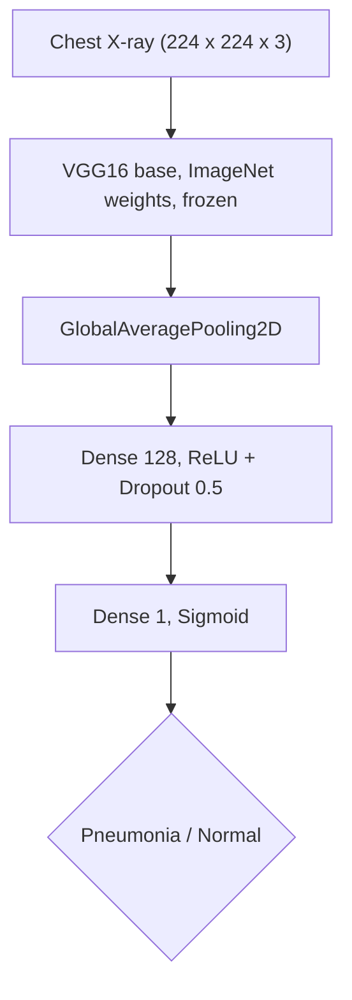
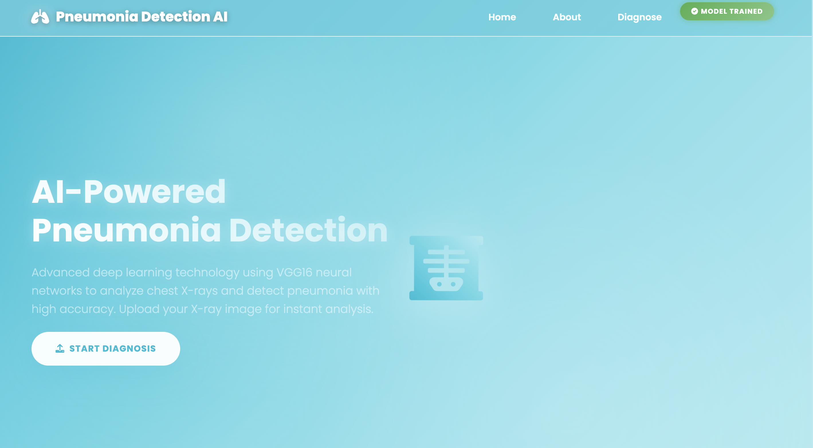
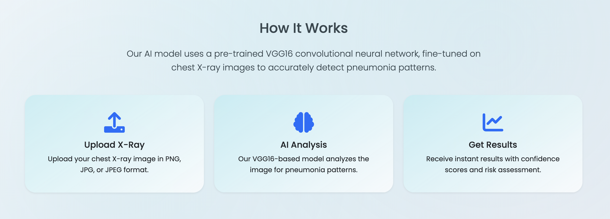
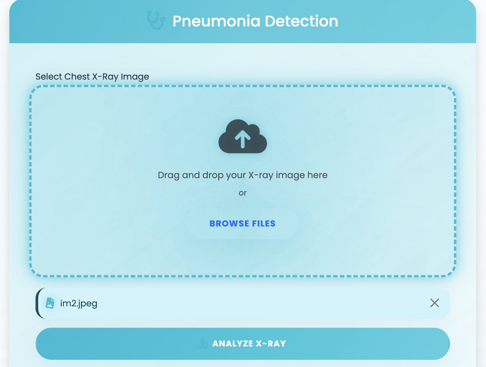
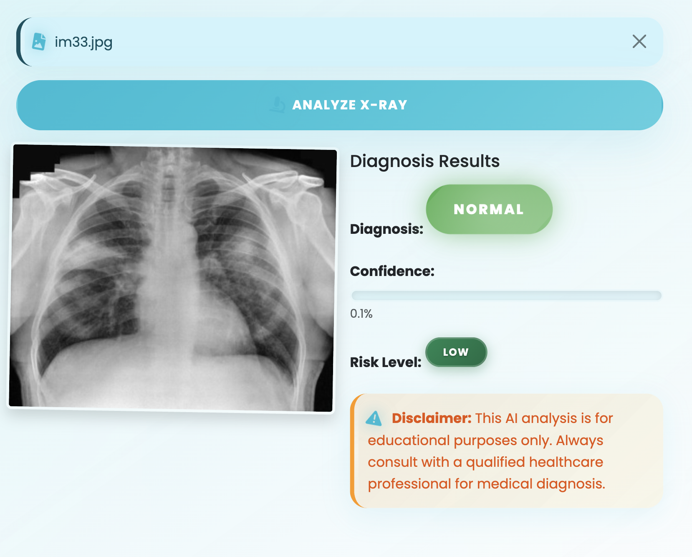

# PulmoSight

A web app that classifies chest X-rays as pneumonia or normal using a VGG16 transfer-learning model.

> **Status:** showcase repository. It contains only this README and screenshots of the app. The source code, training scripts and model weights are not published here.

## Overview

PulmoSight (shown in the UI as "Pneumonia Detection AI") lets a user upload a chest X-ray and get a binary prediction (Pneumonia or Normal) with a confidence score and a risk level. The model uses transfer learning on a VGG16 network pretrained on ImageNet. It was trained on pneumonia and normal images from the NIH ChestX-ray14 dataset, and a Flask web app serves it.

## Features

As shown in the screenshots below:

- **Image upload**: drag and drop, or browse for a PNG, JPG or JPEG chest X-ray.
- **Prediction**: a diagnosis label (Pneumonia or Normal) shown next to the uploaded image.
- **Confidence and risk**: a confidence bar with a percentage and a risk-level badge.
- **Model status**: a "Model Trained" indicator in the navigation bar.
- **Built-in disclaimer**: every result reminds the user that the output is for education only.

## Tech stack

The stack below is as described by the author. It cannot be verified from this repository.

| Layer | Technology |
| --- | --- |
| Model | TensorFlow / Keras, VGG16 (ImageNet weights) |
| Web app | Flask, HTML/CSS |
| Data | NIH ChestX-ray14 (Pneumonia vs. Normal subset) |

## Model design

Preprocessing, as described by the author: filter the labels to Pneumonia vs. Normal, balance the classes, and resize the images to 224 x 224.

## Dataset

- **Source**: [NIH Chest X-rays on Kaggle](https://www.kaggle.com/datasets/nih-chest-xrays/data) (NIH Clinical Center)
- **Contents**: 112,120 frontal chest X-rays from over 30,000 patients, with 14 disease labels in `Data_Entry_2017.csv`
- **Size**: about 40 GB

## Screenshots

**Landing page**

**How it works**

**Upload**

**Prediction result**

## Medical disclaimer

This project is for education and research only. It is not a medical device and must not be used for clinical diagnosis or treatment decisions. Always consult a qualified healthcare professional.

## Acknowledgments

- NIH Clinical Center for the ChestX-ray14 dataset
- The Visual Geometry Group (Oxford) for the VGG16 architecture
- The TensorFlow/Keras and Flask communities

---

Built by [Abhishek Yadav](https://github.com/abhiishek340)
